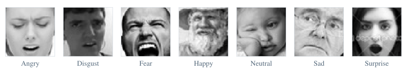
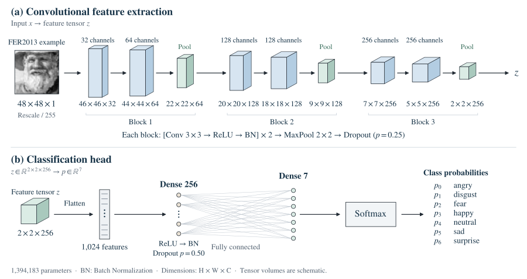
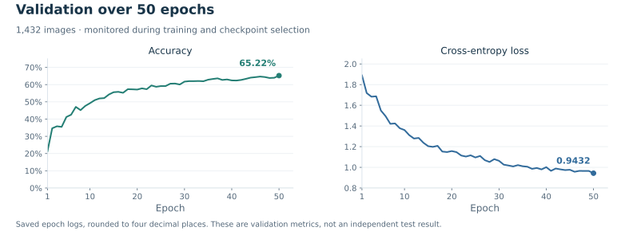

# Facial Expression Recognition

Given a **48 × 48 grayscale image** of a face, the model predicts one of seven expression labels in FER2013. For my bachelor’s thesis, I built a convolutional neural network in Keras and trained it from scratch. Its best checkpoint classified **65.22% of the 1,432 validation images** correctly.

[Training notebook](notebooks/zavrsni.ipynb) · [Experiment details](docs/experiment.md)

## Expression classes

**Figure 1.** One FER2013 example per class, in the order used by the classifier (*angry*, *disgust*, *fear*, *happy*, *neutral*, *sad*, *surprise*). [Image source](assets/source/README.md).

I counted the images in each class before training. The full training directory contains 7,215 images labelled *happy* and just 436 labelled *disgust*, so accuracy across all seven classes tells us little about how well the model recognises the rarest expression. [Class counts](docs/data.md#images-per-class).

## Architecture

I used three convolutional blocks to extract features from the face. Each block applies two 3 × 3 convolutions with Batch Normalization, followed by max pooling and Dropout. As the spatial dimensions shrink, the network uses more channels. By the third pooling layer, the original face is represented by a **2 × 2 × 256** tensor.

**Figure 2.** Tensor dimensions are height × width × channels. The volumes are schematic. [Layer-by-layer architecture](docs/architecture.md).

The classifier flattens the tensor into 1,024 values and feeds them to a 256-unit dense layer. A seven-class softmax gives a score for each expression. The model has **1,394,183 parameters**, of which **1,391,943 are trainable**.

## Recorded experiment

I trained on **22,968 images** and used a separate subset of **1,432 images** from the FER2013 `test/` directory for validation. I rescaled pixel values to 0–1 in both subsets. During training I also shifted images horizontally and vertically and flipped some left to right, so the network saw the same faces in slightly different positions. [Preprocessing settings](docs/data.md#image-preprocessing).

I trained the model for **50 epochs** with Adam, a learning rate of **0.0001**, a batch size of **64** and categorical cross-entropy. After each epoch, Keras evaluated the model on the validation subset and saved the weights whenever validation accuracy improved. [Training configuration](docs/experiment.md#training-configuration).

| Point in the run | Validation accuracy | Validation cross-entropy |
| --- | ---: | ---: |
| Epoch 1 | 21.30% | 1.8888 |
| Epoch 50 (best checkpoint) | **65.22%** | **0.9432** |

**Figure 3.** The highest validation accuracy and the lowest validation loss occurred at epoch 50. [Recorded metrics](results/epoch_metrics.csv).

This score comes from one run on the subset used to select the checkpoint. The notebook does not report a separate final test score. I also checked how the notebook built its confusion matrix. The validation generator shuffled the images while the label vector stayed in directory order. That makes the matrix unsuitable for per-class results. [Evaluation details](docs/experiment.md#recorded-results).

I used Python with TensorFlow/Keras for the CNN, NumPy to select the predicted class from the output scores and Matplotlib and Seaborn to plot the results.

## Repository guide

| Resource | Contents |
| --- | --- |
| [Notebook](notebooks/zavrsni.ipynb) · [Notebook guide](notebooks/README.md) | Image loading, augmentation, model definition, training logs and plots. |
| [Data](docs/data.md) · [Architecture](docs/architecture.md) | Dataset examples, images per class, preprocessing and layer dimensions. |
| [Experiment](docs/experiment.md) · [Results](results/README.md) | Hyperparameters, learning curves and metric tables. |
| [Execution](docs/reproduction.md) · [References](docs/references.md) | Environment, notebook setup, figure commands and thesis reference. |

*Bachelor's thesis, University of Zagreb, Faculty of Electrical Engineering and Computing (FER), June 2025. Supervised by Prof. Sonja Grgić, PhD.*
