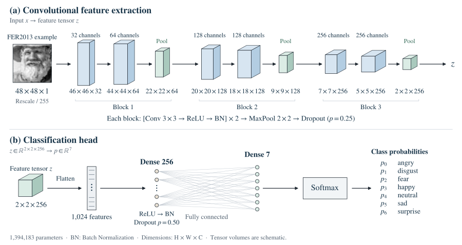

# Model architecture

I built the CNN with Keras `Sequential` and trained it from scratch on **48 × 48 × 1** grayscale images.

**Figure 1.** (a) Convolutional feature extraction produces a **2 × 2 × 256** tensor. (b) Flattening and a **256-unit dense layer** produce seven Softmax outputs. Tensor volumes are schematic. [Image source](../assets/source/README.md).

## Feature extraction

I grouped the six convolutions into **three blocks**. Each convolution uses a **3 × 3 kernel**, stride 1, valid padding and a ReLU activation. Valid padding reduces the height and width by two pixels at each convolution. Batch Normalization then uses batch statistics to normalise the activations in each channel during training.

After the second convolution in each block, 2 × 2 max pooling halves the spatial dimensions, rounding down when needed. Dropout at 0.25 randomly sets some activations to zero during training, so later layers see a different subset of features at each update.

| Stage | Convolution outputs | Output after pooling |
| --- | --- | --- |
| Input | — | 48 × 48 × 1 |
| Block 1 | 46 × 46 × 32; 44 × 44 × 64 | 22 × 22 × 64 |
| Block 2 | 20 × 20 × 128; 18 × 18 × 128 | 9 × 9 × 128 |
| Block 3 | 7 × 7 × 256; 5 × 5 × 256 | 2 × 2 × 256 |

The first convolution produces 32 channels. By the last pooling stage, the network has 256 channels and only four spatial positions per channel.

## Classifier

Flattening the **2 × 2 × 256** tensor keeps all **1,024 values** in a single vector. A dense layer combines them using **256 ReLU units**. I applied Batch Normalization and **Dropout at 0.5** before the final **seven-unit softmax**.

The seven output scores sum to one. I used the index of the highest score to select a label. The generator orders the labels alphabetically (`angry`, `disgust`, `fear`, `happy`, `neutral`, `sad`, `surprise`).

## Layer shapes and parameters

These shapes follow the notebook’s `model.summary()` and omit the batch dimension. [Layer values as CSV](../results/architecture.csv).

| Layer | Output shape | Parameters |
| --- | --- | ---: |
| Conv2D, 32 filters | 46 × 46 × 32 | 320 |
| Batch Normalization | 46 × 46 × 32 | 128 |
| Conv2D, 64 filters | 44 × 44 × 64 | 18,496 |
| Batch Normalization | 44 × 44 × 64 | 256 |
| Max pooling 2 × 2 | 22 × 22 × 64 | 0 |
| Dropout 0.25 | 22 × 22 × 64 | 0 |
| Conv2D, 128 filters | 20 × 20 × 128 | 73,856 |
| Batch Normalization | 20 × 20 × 128 | 512 |
| Conv2D, 128 filters | 18 × 18 × 128 | 147,584 |
| Batch Normalization | 18 × 18 × 128 | 512 |
| Max pooling 2 × 2 | 9 × 9 × 128 | 0 |
| Dropout 0.25 | 9 × 9 × 128 | 0 |
| Conv2D, 256 filters | 7 × 7 × 256 | 295,168 |
| Batch Normalization | 7 × 7 × 256 | 1,024 |
| Conv2D, 256 filters | 5 × 5 × 256 | 590,080 |
| Batch Normalization | 5 × 5 × 256 | 1,024 |
| Max pooling 2 × 2 | 2 × 2 × 256 | 0 |
| Dropout 0.25 | 2 × 2 × 256 | 0 |
| Flatten | 1,024 | 0 |
| Dense, 256 ReLU units | 256 | 262,400 |
| Batch Normalization | 256 | 1,024 |
| Dropout 0.5 | 256 | 0 |
| Dense, 7 Softmax units | 7 | 1,799 |
| **Total** | | **1,394,183** |

Of the total, **1,391,943 parameters are trainable**. The other **2,240** store the moving statistics used by Batch Normalization.

For a convolution with a bias term, the count is `(kernel_height × kernel_width × input_channels + 1) × output_channels`. A dense layer has `(input_units + 1) × output_units`. Each Batch Normalization layer has four values per channel: two trainable parameters and two moving statistics. Pooling, Dropout and Flatten have no trainable parameters.

[Experiment and results](experiment.md) · [References](references.md) · [Overview](../README.md)
