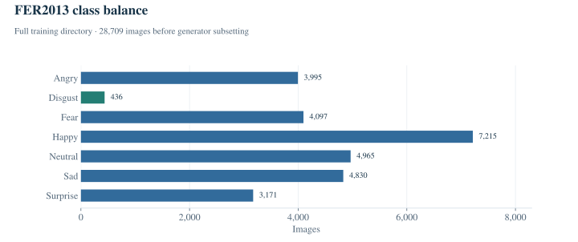

# Data and preprocessing

The notebook downloads the directory-based FER2013 release using `kagglehub.dataset_download("msambare/fer2013")`. Its saved listing contains **28,709 images in `train/`** and **7,178 in `test/`**, for **35,887 images** in total. These directory totals describe the source dataset, not the number of images used by the run.

## Class balance

| Label | Source `train/` | Source `test/` |
| --- | ---: | ---: |
| angry | 3,995 | 958 |
| disgust | 436 | 111 |
| fear | 4,097 | 1,024 |
| happy | 7,215 | 1,774 |
| neutral | 4,965 | 1,233 |
| sad | 4,830 | 1,247 |
| surprise | 3,171 | 831 |
| **Total** | **28,709** | **7,178** |

These counts are extracted from notebook cell 1's saved directory listing. The chart shows the complete source training directory **before** the generator applies its subset rule. It is not a fresh scan of downloaded data. See [class_counts.csv](../results/class_counts.csv).

`Happy` makes up approximately 25.1% of the source training images; `disgust` accounts for approximately 1.5%. This is an observed imbalance in the data. It does not, by itself, establish the model's recall for either class.

## Image pipeline

| Setting | Training generator | Validation generator |
| --- | --- | --- |
| Loader | Keras `ImageDataGenerator.flow_from_directory` | Same loader |
| Target size | 48 × 48 | 48 × 48 |
| Colour mode | Grayscale | Grayscale |
| Pixel rescaling | `1./255` | `1./255` |
| Labels | Categorical / one-hot | Categorical / one-hot |
| Batch size | 64 | 64 |
| Width / height shifts | Up to 0.1 of the image dimension | None configured |
| Horizontal flips | Enabled | Disabled by default |
| Shuffle | Default `True` | Default `True` |
| Explicit random seed | None | None |

The code does not implement a separate face detector, alignment stage or background-removal model. It operates on the images provided in FER2013. Imports such as OpenCV and `compute_class_weight` are not evidence that these techniques were used: neither is called in this notebook's training pipeline.

## The split actually used

Both generators set `validation_split=0.2`, but they read **different directories**:

| Generator | Directory | Subset argument | Saved number of images | Role |
| --- | --- | --- | ---: | --- |
| Training | `train/` | `training` | **22,968** | Gradient updates |
| Validation | `test/` | `validation` | **1,432** | Per-epoch validation and checkpoint selection |

This is not a conventional 80/20 division of one training directory. Keras selects the relevant fraction within each class directory. The totals are confirmed by the saved `Found ... images belonging to 7 classes` output in cell 2.

The selected training data excludes 5,741 images from `train/`; the selected validation data excludes 5,746 images from `test/`. These excluded images have no additional evaluation role in the saved run. The directory listing also shows both `PublicTest_` and `PrivateTest_` filenames under `test/`, so the reported result should not be presented as a standard FER2013 private-test benchmark.

No separate evaluation on the entire untouched test directory is saved. A future experiment should define training, validation and test roles explicitly before training; that would be a new protocol and should be reported separately.

## Data access

FER2013 images are obtained from the [source Kaggle dataset](https://www.kaggle.com/datasets/msambare/fer2013). The repository contains the original notebook and small evidence extracts, rather than a copy of the image dataset. Refer to the provider for data access and distribution terms.

Implementation reference: [Keras 3.8.0 directory iterator and subset logic](https://github.com/keras-team/keras/blob/v3.8.0/keras/src/legacy/preprocessing/image.py).

[Experiment](experiment.md) · [Running the notebook](reproduction.md) · [Back to overview](../README.md)
