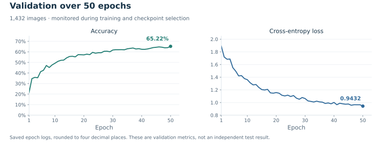

# Experiment and results

This notebook records one 50-epoch run of the [CNN described here](architecture.md). The experiment asks how a convolutional classifier learns the seven FER2013 expression categories from 48 × 48 grayscale images. It uses online image augmentation, Batch Normalization and Dropout, and monitors validation accuracy and cross-entropy during training.

## Training configuration

| Setting | Value in the implementation | Source cell |
| --- | --- | --- |
| Dataset download | `msambare/fer2013` via KaggleHub | 1 |
| Training images | 22,968 | 2, saved output |
| Validation images | 1,432 | 2, saved output |
| Input | 48 × 48 × 1, grayscale, rescaled by `1./255` | 2 |
| Labels | Seven classes, categorical encoding | 2 |
| Training augmentation | Width/height shifts 0.1; horizontal flip | 2 |
| Batch size | 64 | 2 |
| Optimiser | Adam | 3 |
| Learning rate | **0.0001** | 3 |
| Objective | Categorical cross-entropy | 3 |
| Fit metric | Accuracy | 3 |
| Epochs | 50 | 4, code and saved output |
| Steps | `len(train_generator)` / `len(validation_generator)`; saved logs show 359 / 23 batches | 4 / 8 |
| Checkpoint | `model.weights.h5`; weights only; best `val_accuracy`, maximised | 4 |
| Early stopping / LR schedule | Not configured | 4 |
| Fixed random seed | Not set | 2–4 |

The validation set comes from a subset of the source `test/` directory and is used during training. See the [exact split](data.md#the-split-actually-used) before comparing the result with any external benchmark.

## Recorded results

| Quantity | Saved value |
| --- | ---: |
| Best validation accuracy | **0.6522 / 65.22%** |
| Epoch of best validation accuracy | **50** |
| Validation loss at epoch 50 | **0.9432** |
| Lowest recorded validation loss | **0.9432**, epoch 50 |
| Final training accuracy in the saved history summary | 0.6368 / 63.68% |
| Final training loss in the saved history summary | 0.9747 |

These values are read from the printed `history.history` summary in cell 7. The epoch-50 checkpoint message reports validation accuracy to five decimals, `0.65223`; the summary rounds this to `0.6522`.



The figure uses [epoch_metrics.csv](../results/epoch_metrics.csv), extracted from the saved epoch-end console lines in cell 4. Values there are rounded to four decimal places. The figure plots only validation metrics: the final training console values, `0.6327` accuracy and `0.9799` loss, differ from the history summary's `0.6368` and `0.9747`. Both records remain available; they are not silently combined into one training curve.

## Reading the learning curves

Validation accuracy rises from 21.30% in the first epoch to 65.22% in epoch 50, while validation loss decreases from 1.8888 to 0.9432. Improvement slows in the later epochs, but the best recorded score is still at the end of the run. These observations do not establish that further training would improve the model, or that epoch 50 is optimal beyond this run.

The original plots and history summary show validation accuracy slightly above training accuracy. Training includes random augmentation and active Dropout; validation is evaluated without those training-time transformations. The conditions are therefore different. The curves alone are not proof of generalisation to new populations or the absence of overfitting. See the [Keras explanation of training versus validation loss](https://keras.io/getting_started/faq/#why-is-my-training-loss-much-higher-than-my-testing-loss).

## Evaluation details

### Validation and test roles

The same 1,432-image validation subset is monitored after every epoch and determines which checkpoint is saved. The notebook does not report a separate full-test evaluation after model selection. Consequently, the reported 65.22% should be described as **best recorded validation accuracy for this run**.

### Confusion-matrix ordering

Cell 8 performs these operations:

```python
validation_labels = validation_generator.classes
validation_pred_probs = model.predict(validation_generator)
validation_pred_labels = np.argmax(validation_pred_probs, axis=1)
confusion_mtx = confusion_matrix(validation_labels, validation_pred_labels)
```

The generator in cell 2 does not set `shuffle=False`. Its default is `True`, so prediction order does not match the fixed-order `.classes` vector. Batch labels are paired correctly during `fit()` validation; the issue concerns the later, separately assembled confusion matrix.

The saved matrix has 269 diagonal entries out of 1,432 observations, approximately 18.78%, which is inconsistent with the recorded validation accuracy. This calculation is a consistency check on the saved artefact, **not a new model score**. Class-specific recall, precision and F1 cannot be established from that matrix. In particular, its zero diagonal entry for `disgust` does not justify concluding that the trained model never recognises that class.

To repeat this part of evaluation, recreate the same validation subset with `shuffle=False`, load the matching trained weights, and pair its predictions with its own class labels. No corrected matrix is included here because the supplied attachments do not contain the checkpoint. Changing prediction order does not require retraining if the original weights can be recovered.

Implementation reference: [Keras 3.8.0 `DirectoryIterator` and `ImageDataGenerator`](https://github.com/keras-team/keras/blob/v3.8.0/keras/src/legacy/preprocessing/image.py).

### Scope of the conclusions

The saved outputs support the implementation, configuration and learning trend described above. They do not provide repeated runs, cross-validation, uncertainty intervals, an independently evaluated test score or a controlled comparison against another architecture. Class weighting and oversampling are not applied in the recorded training call.

The problem is classification of **dataset expression labels** from images. The experiment does not validate a person's internal emotional state or establish suitability for clinical or other consequential decisions.

## Further experiments

The following would extend the project; they are not completed results:

1. Recover the weights and repeat prediction with fixed ordering; report per-class precision, recall, F1 and support, plus macro F1.
2. Define training/validation/test roles before a new run, keeping the final test set outside model selection.
3. Compare class weighting with the original loss under the same split, training budget and seeds.
4. Evaluate augmentation or regularisation changes one at a time, rather than attributing improvements to several simultaneous changes.

[Evidence and source differences](evidence.md) · [Execution notes](reproduction.md) · [Back to overview](../README.md)
